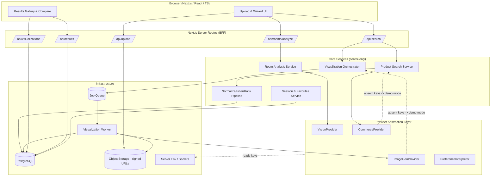
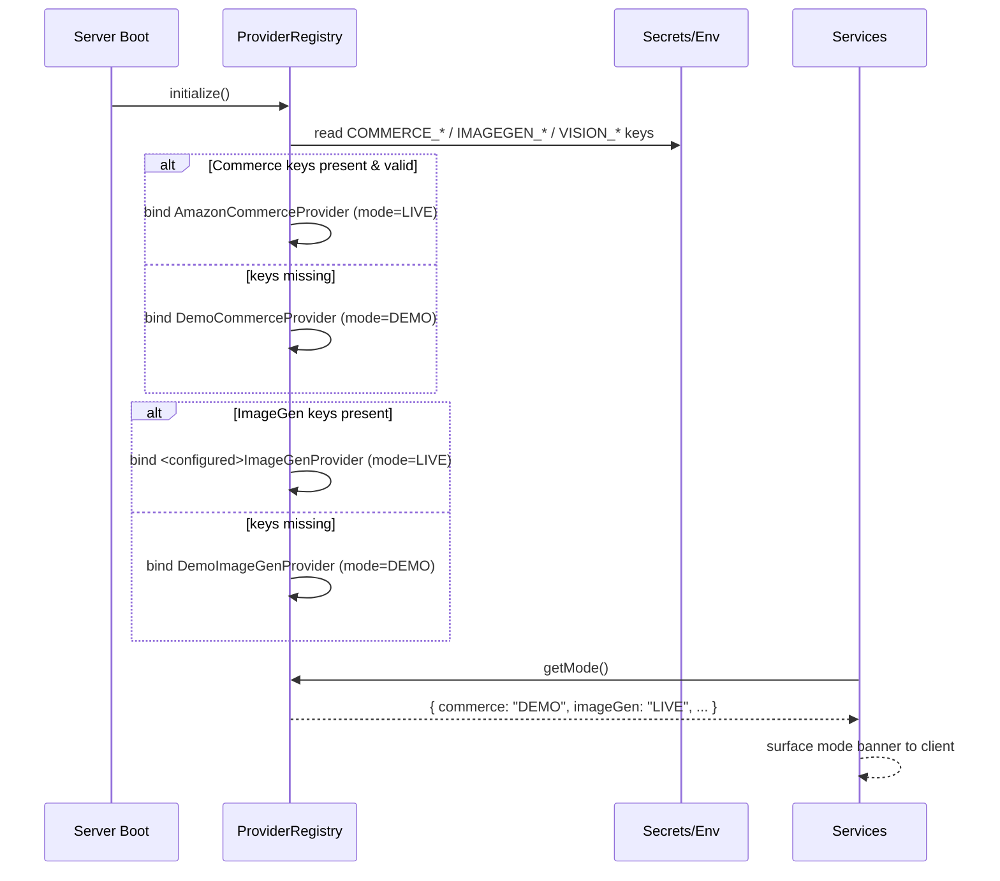
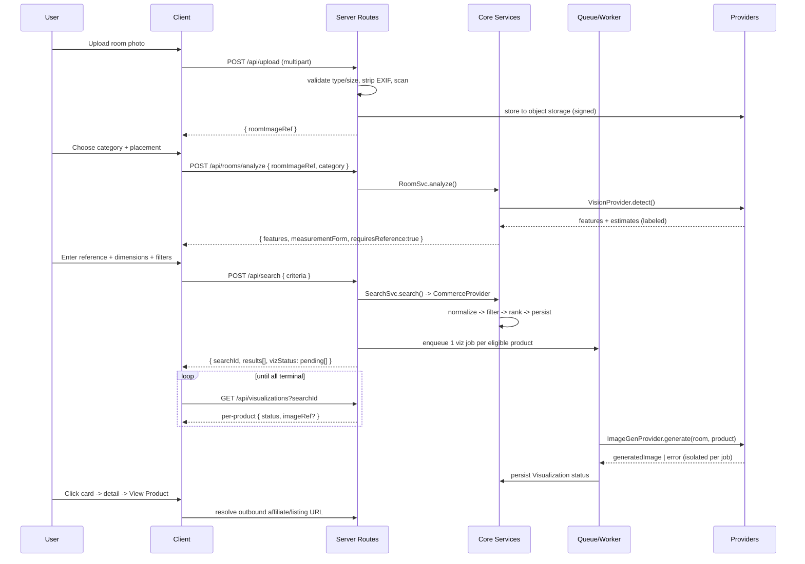

# Design Document: AI Furniture Finder & Room Visualizer

## Overview

The AI Furniture Finder is a responsive web application that helps users discover furniture that fits their physical space, matches their style preferences, and stays within budget. Users upload a photo of an empty area in their room, choose a furniture category, provide room measurements (anchored to at least one real reference measurement), and set preferences. The system searches Amazon through an authorized product-advertising integration, filters and ranks products against verified specifications, and generates AI visualizations of each eligible product placed in the user's actual room.

The architecture prioritizes **trustworthiness over convincing appearance**. Fit assessment is driven exclusively by verified product dimensions and user-confirmed measurements — never by the AI-generated image, which is explicitly treated as an approximate representation. The design centers on four cross-cutting concerns: (1) a **provider-swappable AI abstraction** so vision, visualization, and NL-interpretation providers can be exchanged without touching business logic; (2) a **demonstration mode** that activates automatically when Amazon or AI credentials are absent, returning clearly labeled sample data instead of faking live calls; (3) an **asynchronous visualization pipeline** where each product's image generation runs as an isolated job so one failure never blocks the rest; and (4) **strict server-side custody** of all credentials and uploaded images, with signed, access-controlled object storage.

The stack is Next.js (App Router) + React + TypeScript on the frontend, Next.js server routes plus a background job worker on the backend, PostgreSQL (via Supabase or equivalent) for structured data, and object storage for room photos and generated images. All external integrations sit behind interfaces, and the entire product journey degrades gracefully when any dependency is unavailable.

## Architecture



**Key architectural decisions:**

- **Backend-for-Frontend (BFF):** The browser never calls Amazon or AI providers directly. All external traffic is proxied through server routes so credentials stay server-side and policy (rate limits, attribution, affiliate disclosure) is enforced centrally.
- **Provider abstraction layer:** Every external capability (vision, commerce, image generation, NL interpretation) is accessed through a TypeScript interface. A `ProviderRegistry` resolves the concrete implementation at runtime based on configured credentials, falling back to a `Demo*` implementation when credentials are missing.
- **Async visualization via queue + worker:** Image generation is slow and failure-prone, so it is dispatched as per-product jobs. Results stream back to the client via polling of `/api/visualizations`. One job's failure updates only that job's status.
- **Fit decided before visualization:** The filter/rank pipeline computes `fitStatus` from verified specs and confirmed measurements. Visualization is downstream and purely presentational; it can never upgrade a `NEEDS_VERIFICATION` product to `FITS`.

## Capability & Mode Resolution



The client receives a `capabilities` payload describing which subsystems are LIVE vs DEMO so the UI can render honest banners ("Demonstration Mode — sample products shown"). No subsystem ever pretends to be live.

## Main User Workflow (Async)



## Components and Interfaces

### Component 1: Upload & Validation Service

**Purpose**: Securely accept room photos, validate them, strip metadata, and store them behind signed URLs.

**Responsibilities**:
- Enforce allowed MIME types (JPEG/PNG/WebP) and max file size.
- Strip EXIF/GPS metadata before persistence.
- Generate access-controlled storage references; never return raw public URLs.
- Reject corrupt or oversized uploads with actionable errors.

**Interface**:
```typescript
interface UploadService {
  validateUpload(file: UploadInput): ValidationResult;
  storeRoomImage(file: UploadInput, sessionId: string): Promise<StoredImage>;
  getSignedViewUrl(ref: ImageRef, ttlSeconds: number): Promise<string>;
  deleteImage(ref: ImageRef): Promise<void>;
}
```

### Component 2: Room Analysis Service

**Purpose**: Use computer vision to detect room features and produce a category-specific measurement form, enforcing the reference-measurement rule.

**Responsibilities**:
- Call `VisionProvider` to detect walls/floor/windows/doors/corners/obstacles and a candidate placement area.
- Classify image quality (too dark/blurry/insufficient coverage) and surface guidance.
- Produce a dynamic measurement form keyed by furniture category.
- Require at least one user-supplied reference measurement; mark all AI-derived values as `estimate`.

**Interface**:
```typescript
interface RoomAnalysisService {
  analyze(input: AnalyzeInput): Promise<RoomAnalysis>;
  buildMeasurementForm(category: FurnitureCategory): MeasurementForm;
}
```

### Component 3: Product Search Service

**Purpose**: Query the authorized commerce integration and return normalized product candidates (or demo data).

**Responsibilities**:
- Translate `SearchCriteria` into a provider query.
- Enforce rate limits, attribution, and affiliate-disclosure policy.
- Return raw provider products for the normalization pipeline.
- In DEMO mode, return clearly labeled sample products.

**Interface**:
```typescript
interface CommerceProvider {
  readonly mode: ProviderMode; // "LIVE" | "DEMO"
  search(query: CommerceQuery): Promise<RawProduct[]>;
  resolveOutboundUrl(product: Product): OutboundLink; // listing or affiliate
}
```

### Component 4: Normalize / Filter / Rank Pipeline

**Purpose**: Turn raw products into ranked, fit-assessed results using only verified specifications.

**Responsibilities**:
- Normalize dimensions to a canonical unit (millimeters) and currency.
- Reject products exceeding hard size constraints.
- Apply mandatory budget/preference filters.
- Flag products with missing/ambiguous dimensions as `NEEDS_VERIFICATION` and exclude them from strict-fit guarantees.
- Rank eligible products by weighted score (dimensional fit, style, material, color, price, rating).

**Interface**:
```typescript
interface FilterRankService {
  process(raw: RawProduct[], criteria: SearchCriteria): RankedResult[];
}
```

### Component 5: Visualization Orchestrator + Worker

**Purpose**: Generate one in-room image per eligible product asynchronously with per-product failure isolation.

**Responsibilities**:
- Enqueue a job per eligible product with cancel/retry support.
- Call `ImageGenProvider` with the room photo + product reference image.
- Persist terminal status; never allow one failure to abort siblings.
- Cache generated images when provider policy permits.

**Interface**:
```typescript
interface VisualizationOrchestrator {
  enqueueForSearch(searchId: string, products: RankedResult[]): Promise<VizBatch>;
  getStatus(searchId: string): Promise<VizJobStatus[]>;
  retry(vizId: string): Promise<void>;
  cancel(vizId: string): Promise<void>;
}

interface ImageGenProvider {
  readonly mode: ProviderMode;
  generate(input: VizGenInput): Promise<VizGenOutput>; // throws -> isolated job failure
}
```

### Component 6: Session & Favorites Service

**Purpose**: Persist search sessions, results, and favorites (session-scoped in v1; account-scoped if auth enabled).

**Interface**:
```typescript
interface SessionService {
  createSession(): Promise<SessionId>;
  saveFavorite(sessionId: string, productId: string): Promise<void>;
  listFavorites(sessionId: string): Promise<Product[]>;
  getSearch(searchId: string): Promise<SearchResultView>;
}
```

### Component 7: Provider Registry

**Purpose**: Resolve concrete providers from configuration and expose system capabilities/modes.

**Interface**:
```typescript
interface ProviderRegistry {
  vision(): VisionProvider;
  commerce(): CommerceProvider;
  imageGen(): ImageGenProvider;
  preferences(): PreferenceInterpreter;
  capabilities(): SystemCapabilities; // per-subsystem LIVE/DEMO
}
```

## Data Models

### Model: RoomProject
```typescript
interface RoomProject {
  id: string;                          // uuid
  userId: string | null;               // null when unauthenticated
  originalImageRef: ImageRef;          // storage reference, not public URL
  furnitureCategory: FurnitureCategory;
  placementArea: PlacementArea;        // "against_wall" | "beside_window" | "corner" | "center"
  roomDimensions: RoomDimensions;      // canonicalized to mm
  measurementConfidence: MeasurementConfidence; // "confirmed" | "estimated" | "mixed"
  createdAt: string;                   // ISO-8601
}
```
**Validation Rules**:
- `originalImageRef` must resolve to an owned, non-expired storage object.
- `roomDimensions` must include at least one `confirmed` reference value; otherwise `measurementConfidence` cannot be `confirmed`.

### Model: SearchCriteria
```typescript
interface SearchCriteria {
  roomProjectId: string;
  maximumDimensions: Dimensions;       // hard cap, required (mm)
  minimumDimensions?: Partial<Dimensions>;
  budgetMin?: Money;
  budgetMax?: Money;
  preferredColors: string[];
  preferredMaterials: Material[];      // wood | metal | leather | velvet | fabric
  preferredStyles: InteriorStyle[];    // scandinavian | minimalist | modern | industrial | traditional | mid_century
  minRating?: number;
  minReviewCount?: number;
  condition?: ProductCondition;
  freeText?: string;                   // "Describe your ideal furniture"
  strictFields: StrictFieldFlags;      // which criteria are hard requirements
}
```
**Validation Rules**:
- `maximumDimensions` is required and must be positive on each present axis.
- If `budgetMin` and `budgetMax` both set, `budgetMin <= budgetMax`.
- Any field marked strict must be present and well-formed.

### Model: Product
```typescript
interface Product {
  productId: string;
  source: "amazon" | "demo";
  title: string;
  brand?: string;
  productImageUrl: string;             // provider-hosted, policy-compliant
  productUrl: string;                  // canonical listing
  affiliateUrl?: string;               // only when authorized
  price?: Money;
  dimensions?: Partial<Dimensions>;    // mm; may be incomplete
  material?: Material;
  color?: string;
  rating?: number;
  reviewCount?: number;
  availability?: string;
  specificationCompleteness: SpecCompleteness; // "complete" | "partial" | "missing"
  lastVerifiedAt: string;
}
```
**Validation Rules**:
- A product with `specificationCompleteness !== "complete"` on required dimension axes must never be assigned `FITS`.
- No field may be synthesized; absent provider data stays absent.

### Model: Visualization
```typescript
interface Visualization {
  id: string;
  roomProjectId: string;
  productId: string;
  generatedImageRef: ImageRef | null;
  generationStatus: VizStatus;         // "pending" | "generating" | "completed" | "failed" | "canceled"
  failureReason?: string;
  createdAt: string;
}
```
**Validation Rules**:
- `generatedImageRef` is non-null only when `generationStatus === "completed"`.
- Status transitions are monotonic toward a terminal state; a failure is isolated to this row.

### Shared Value Types
```typescript
type FitStatus = "FITS" | "NEEDS_VERIFICATION";
type ProviderMode = "LIVE" | "DEMO";
interface Dimensions { widthMm: number; depthMm: number; heightMm: number; }
interface Money { amount: number; currency: string; }
interface RankedResult { product: Product; fitStatus: FitStatus; score: number; reasons: string[]; }
```

## Algorithmic Pseudocode

### Normalize / Filter / Rank Pipeline

```typescript
function process(raw: RawProduct[], criteria: SearchCriteria): RankedResult[] {
  // Step 2: normalize units & currency
  const normalized = raw.map(normalizeProduct);

  const eligible: RankedResult[] = [];
  for (const p of normalized) {
    // Loop invariant: eligible contains only products that passed every
    // hard constraint evaluated so far, each with a computed fitStatus.

    // Step 5: flag missing/ambiguous dimensions
    const completeness = assessDimensionCompleteness(p, criteria);

    // Step 3: reject hard size violations (only decidable when dims known)
    if (completeness === "complete" && exceedsHardCap(p.dimensions, criteria.maximumDimensions)) {
      continue; // rejected: definitely does not fit
    }
    if (completeness === "complete" && belowMinimum(p, criteria.minimumDimensions)) {
      continue;
    }

    // Step 4: mandatory budget / strict preference filters
    if (!passesStrictFilters(p, criteria)) {
      continue;
    }

    // Fit decision: verified specs only — visuals never influence this
    const fitStatus: FitStatus =
      completeness === "complete" ? "FITS" : "NEEDS_VERIFICATION";

    eligible.push({
      product: p,
      fitStatus,
      score: computeScore(p, criteria),
      reasons: explain(p, criteria, fitStatus),
    });
  }

  // Step 6: rank by weighted score; Step 7: diversify top matches
  eligible.sort((a, b) => b.score - a.score);
  return diversify(eligible);
}
```

**Preconditions**:
- `criteria.maximumDimensions` is present and positive.
- `raw` products carry only provider-sourced data (no synthesized specs).

**Postconditions**:
- Every returned `RankedResult` passed all strict filters.
- `fitStatus === "FITS"` implies all required dimension axes were verified-complete and within caps.
- No rejected-for-size product with complete dimensions appears in the output.

**Loop Invariants**:
- `eligible` holds only products that satisfied every hard constraint checked so far.
- A product's `fitStatus` is derived solely from `completeness` and dimension comparison, independent of any visualization.

### Visualization Dispatch (Per-Product Isolation)

```typescript
async function enqueueForSearch(searchId: string, products: RankedResult[]): Promise<VizBatch> {
  const jobs: VizJob[] = [];
  for (const r of products) {
    // One job per product; each is independently cancelable/retryable.
    const viz = await createVisualizationRow(searchId, r.product.productId, "pending");
    jobs.push(await queue.enqueue({ vizId: viz.id, searchId, productId: r.product.productId }));
  }
  return { searchId, jobs };
}

async function handleVizJob(job: VizJob): Promise<void> {
  try {
    await updateStatus(job.vizId, "generating");
    const room = await loadRoomImage(job.searchId);
    const product = await loadProductImage(job.productId);
    const out = await registry.imageGen().generate({ room, product });
    const ref = await store(out.image);
    await updateStatus(job.vizId, "completed", { generatedImageRef: ref });
  } catch (err) {
    // Isolation: failure updates ONLY this row. Siblings continue.
    await updateStatus(job.vizId, "failed", { failureReason: safeMessage(err) });
  }
}
```

**Preconditions**:
- Each `product` is an eligible `RankedResult`; room image reference resolves.

**Postconditions**:
- Every job reaches a terminal state (`completed` | `failed` | `canceled`) independently.
- A failed job leaves all other jobs' statuses unchanged.

**Loop Invariants**:
- After each iteration of `enqueueForSearch`, exactly one `pending` visualization row exists per processed product.

### Unit Normalization

```typescript
function toMillimeters(value: number, unit: LengthUnit): number {
  switch (unit) {
    case "mm":    return value;
    case "cm":    return value * 10;
    case "m":     return value * 1000;
    case "in":    return value * 25.4;
    case "ft":    return value * 304.8;
  }
}
```

**Preconditions**: `value >= 0`; `unit` is a supported `LengthUnit`.
**Postconditions**: returns the equivalent length in mm; conversion is exact for the defined factors.

## Key Functions with Formal Specifications

### Function: assessDimensionCompleteness()
```typescript
function assessDimensionCompleteness(p: Product, c: SearchCriteria): SpecCompleteness
```
**Preconditions**: `c.maximumDimensions` identifies which axes are required.
**Postconditions**:
- Returns `"complete"` only if every required axis has a provider-sourced numeric value.
- Returns `"missing"` when no required axis is present; `"partial"` otherwise.
- Never infers a value to upgrade completeness.

### Function: exceedsHardCap()
```typescript
function exceedsHardCap(dims: Partial<Dimensions>, cap: Dimensions): boolean
```
**Preconditions**: comparison axes present in both `dims` and `cap`.
**Postconditions**: returns `true` iff any present axis of `dims` strictly exceeds the corresponding `cap` axis. Absent axes are not treated as fitting.

### Function: resolveOutboundUrl()
```typescript
function resolveOutboundUrl(product: Product): OutboundLink
```
**Preconditions**: `product.source` and `product.productUrl` are set.
**Postconditions**:
- For `source === "amazon"` with authorization, returns `affiliateUrl` plus required disclosure metadata; otherwise returns the canonical `productUrl`.
- For `source === "demo"`, returns a link flagged `demo:true` and never presented as a live purchase path.

## Example Usage

```typescript
// Example 1: End-to-end happy path (LIVE mode)
const stored = await uploadService.storeRoomImage(file, sessionId);
const analysis = await roomService.analyze({ roomImageRef: stored.ref, category: "sofa" });
// analysis.requiresReference === true -> UI blocks until a confirmed measurement is entered

const criteria: SearchCriteria = {
  roomProjectId: project.id,
  maximumDimensions: { widthMm: 2200, depthMm: 950, heightMm: 900 },
  budgetMax: { amount: 800, currency: "USD" },
  preferredStyles: ["scandinavian", "minimalist"],
  preferredColors: ["light oak", "beige"],
  preferredMaterials: ["fabric"],
  strictFields: { maximumDimensions: true, budgetMax: true },
  freeText: "A minimalist Scandinavian sofa in a light neutral tone under $800",
};
const { searchId, results } = await searchService.search(criteria);
await vizOrchestrator.enqueueForSearch(searchId, results);

// Example 2: Fit honesty — missing dimensions never claim a fit
const r = results.find(x => x.product.specificationCompleteness !== "complete");
assert(r === undefined || r.fitStatus === "NEEDS_VERIFICATION");

// Example 3: Demo fallback when credentials absent
if (registry.capabilities().commerce === "DEMO") {
  showBanner("Demonstration Mode — sample products shown, not a live Amazon search.");
}

// Example 4: One visualization fails, others still complete
const statuses = await vizOrchestrator.getStatus(searchId);
assert(statuses.some(s => s.status === "failed") === false ||
       statuses.some(s => s.status === "completed")); // failures do not block siblings
```

## Correctness Properties

- **P1 — Fit requires verification**: For every returned result `r`, `r.fitStatus === "FITS"` implies `r.product.specificationCompleteness === "complete"` on all required axes AND dimensions are within `maximumDimensions`. Formally: `∀ r ∈ results, fitStatus(r) = FITS ⟹ verified(r) ∧ withinCap(r)`.
- **P2 — Visuals never upgrade fit**: The generated visualization has no input into `fitStatus`. `∀ r, fitStatus(r)` is invariant under any value of `Visualization.generationStatus`.
- **P3 — Failure isolation**: `∀ jobs i ≠ j`, the terminal status of job `i` is independent of job `j`. A `failed` job never changes another job's status.
- **P4 — No fabrication**: Every product field is either provider-sourced or absent. `∀ product fields f, value(f) ≠ null ⟹ sourcedFromProvider(f)`.
- **P5 — Unit round-trip**: For supported units, `toMillimeters(v, u)` yields the mathematically exact conversion; filtering decisions use only canonical mm values.
- **P6 — Reference-anchored measurement**: `measurementConfidence = confirmed ⟹ ∃ at least one user-confirmed reference measurement`. No fit claim rests on visual estimation alone.
- **P7 — Credential custody**: No Amazon/AI/storage credential is ever serialized into any client-bound response; all provider calls originate server-side.
- **P8 — Mode honesty**: When any subsystem is in DEMO mode, the client receives `capabilities.<subsystem> === "DEMO"` and the UI must disclose it.

## Error Handling

### Scenario: Invalid or oversized upload
**Condition**: Unsupported MIME type or file exceeds size limit.
**Response**: Reject before storage with a specific message (type vs size).
**Recovery**: User replaces the file; no partial object is persisted.

### Scenario: Low-quality room photo
**Condition**: Vision provider reports dark/blurry/insufficient coverage.
**Response**: Surface photography tips and the specific defect; allow re-upload.
**Recovery**: Analysis re-runs on the new image.

### Scenario: Missing required dimensions / no reference measurement
**Condition**: User has not supplied a confirmed reference.
**Response**: Block search; explain that fit cannot be verified without a reference.
**Recovery**: User enters a reference or manual usable-space dimensions.

### Scenario: Commerce integration unavailable or unauthorized
**Condition**: Credentials absent or provider returns auth error.
**Response**: Switch that subsystem to DEMO mode with a labeled banner; never fake a live search.
**Recovery**: Operator supplies valid credentials; mode re-resolves on next boot/health check.

### Scenario: Products returned without dimensions
**Condition**: Provider omits required dimension axes.
**Response**: Mark `NEEDS_VERIFICATION`; exclude from strict-fit guarantees.
**Recovery**: User may relax strictness to view such items explicitly flagged.

### Scenario: Image generation fails or returns unusable image
**Condition**: Provider error, timeout, or policy rejection (e.g., unusable product reference).
**Response**: Mark only that visualization `failed` with a reason; show product card without the in-room image.
**Recovery**: User retries that single visualization; other products are unaffected.

### Scenario: No products meet all mandatory conditions
**Condition**: Filter pipeline returns empty.
**Response**: Explain which constraints eliminated candidates and offer to relax a specific one.
**Recovery**: User adjusts a named constraint and re-searches without restarting.

### Scenario: Room photo contains people / sensitive info
**Condition**: Vision provider flags faces or personal content.
**Response**: Warn the user, recommend a photo without people; do not persist flagged content beyond processing need.
**Recovery**: User uploads a compliant photo.

## Testing Strategy

### Unit Testing Approach
Cover the pure, high-risk logic directly: unit conversion (`toMillimeters`), dimension filtering (`exceedsHardCap`, `belowMinimum`), budget filtering, fit-status derivation (verified vs needs-verification), and outbound-link resolution (listing vs affiliate vs demo). Include explicit failure-scenario tests: missing dimensions, empty result sets, and provider errors.

### Property-Based Testing Approach
Encode the correctness properties as generative tests.
**Property Test Library**: fast-check (TypeScript/Jest).
- P1/P5: for random products and criteria, any result marked `FITS` has complete, within-cap dimensions in canonical mm.
- P3: for random batches with injected failures, terminal status of each job is independent of others.
- P4: fuzz provider payloads with missing fields; assert no output field is ever non-null unless present in input.

### Integration Testing Approach
Exercise the full async flow against DEMO providers: upload → analyze → search → enqueue → poll visualizations → results. Verify mode banners, per-product failure isolation with a deliberately failing demo image job, and that credentials never appear in any client response.

## Performance Considerations
- Visualizations run asynchronously via a job queue so slow generation never blocks HTTP responses; results stream in via polling with progress/skeleton states.
- Generated images are cached by `(roomImageRef, productImageRef)` when provider policy permits, avoiding regeneration on re-sort or revisit.
- Search and ranking operate on normalized, in-memory candidate sets; DB writes are batched per search.
- Signed storage URLs use short TTLs to bound exposure while keeping delivery fast.

## Security Considerations
- All Amazon/AI/storage credentials live only in server environment variables; the browser never receives them (P7).
- Uploaded images are stored in access-controlled object storage, served via short-lived signed URLs, with EXIF/GPS metadata stripped on ingest.
- Retention is minimal with explicit deletion support for photos and projects.
- Affiliate relationships are disclosed per policy; demo links are clearly flagged and non-transactional.
- Vision flagging of people/sensitive content gates persistence.

## Dependencies
- **Frontend**: Next.js (App Router), React, TypeScript, Tailwind CSS.
- **Backend**: Next.js server routes; background job queue + worker (e.g., queue service or DB-backed worker).
- **Database**: PostgreSQL (Supabase or equivalent).
- **Object storage**: Access-controlled store with signed URLs (e.g., Supabase Storage / S3-compatible).
- **Commerce**: Amazon Product Advertising API (or another authorized integration) behind `CommerceProvider`; `DemoCommerceProvider` fallback.
- **AI vision**: pluggable `VisionProvider`; `DemoVisionProvider` fallback.
- **AI image generation**: pluggable reference-conditioned `ImageGenProvider`; `DemoImageGenProvider` fallback.
- **NL interpretation (optional)**: `PreferenceInterpreter` for free-text preferences.
- **Testing**: Jest + fast-check.
- **Config**: `.env.example` enumerating required variables (no secrets); automatic DEMO mode when integration vars are unset.
